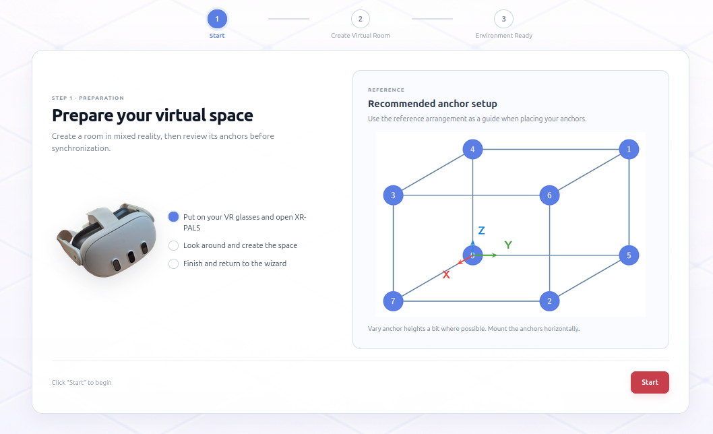
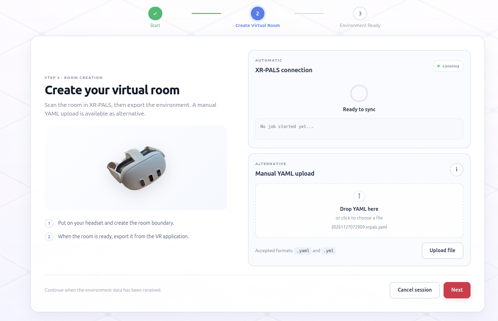
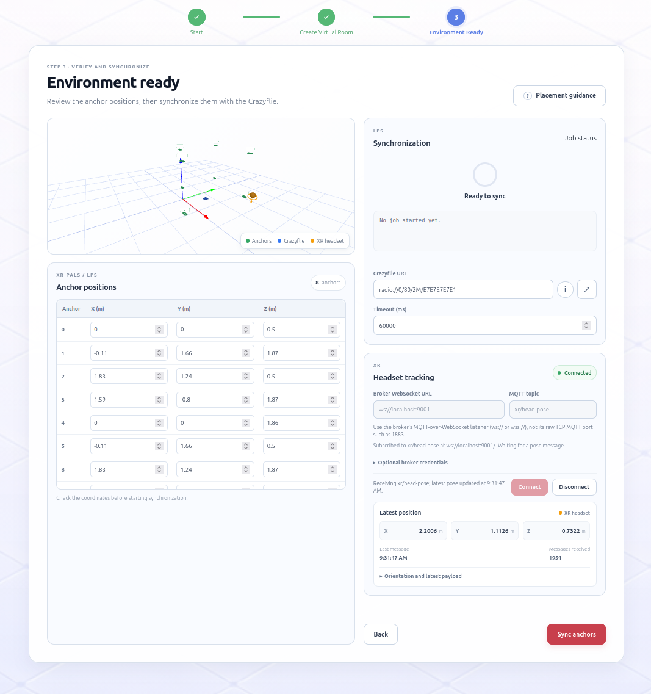

# XR-PALS Wizard

Setting up a Crazyflie Loco Positioning System (LPS) environment involves preparing a physical and virtual space, and checking anchor positions before synchronization. 
The XR-PALS Wizard organizes the whole process into a guided workflow. 
It supports the XR-PALS app as well as manual YAML upload, then provides a 3D view for reviewing the setup and allows to synchronize the virtual with the phyiscal LPS nodes via the Crazyflie. 
Optional live headset tracking with the XR-PALS app helps inspect the positioning environment during setup.

## User Manual

### 1) Prepare the physical space

Prepare the tracking hardware and use the recommended anchor arrangement as a placement reference.

<a href="docs/wizard-step-1.png">
  
</a>

### 2) Create the virtual space

Re-create the space in XR-PALS and export the position data. 
A manual YAML upload is available as an alternative.

<a href="docs/wizard-step-2.png">
  
</a>


### 3) Fine-tune and synchronize

Review the imported anchor coordinates in the 3D preview, optionally inspect live headset pose data, and synchronize the anchor positions with the Crazyflie.

<a href="docs/wizard-step-3.png">
  
</a>

## Run the application

### Starting the Backend
 
```shell
# Windows
$ mvnw.cmd spring-boot:run

# Linux
$ ./mvnw spring-boot:run
```

or

```shell
$ ./mvnw clean package
$ java -jar target/backend-0.0.1-SNAPSHOT.jar
```

#### Configure Upload Directory

You can override the upload location in the following ways.

- Modify or add next to the JAR the `applications.properties`:

```properties
xrpals.uploads-dir=./uploads
```

- Using Environment Variable: `export XRPALS_UPLOADS_DIR=/tmp/xrpals` (Linux/MacOS) or `$env:XRPALS_UPLOADS_DIR="C:\xrpals\uploads"` (Windows)


- Using Spring Boot Maven Plugin

```shell
./mvnw spring-boot:run \
  -Dspring-boot.run.arguments="--xrpals.uploads-dir=/home/user/swarmwalker/config-server/uploads-xrpalswizard"
```

- Via the executable JAR. First build the application and then start it with the upload directory configured:

```shell
java -jar target/backend-0.0.1-SNAPSHOT.jar \
  --xrpals.uploads-dir=/home/user/swarmwalker/config-server/uploads-xrpalswizard
```


### Starting the Frontend

```shell
$ nvm install node --lts
$ nvm use --lts 
$ npm install
$ npm run dev
```

Open the browser at:
[`http://localhost:5173/`](http://localhost:5173/)

### Synchronization and Crazyfly Tracking

> **Prerequisite:** Before starting cf.PyCtrl, install it as a Docker container by following the [cf.PyControl installation instructions](https://github.com/UniAgent-CyberPhysicalAssets/cps.asset.crazyflie/tree/main/controller/cf.PyControl#installation).

#### Start cfPyCtrl for Live-Tracking (optional)

Install the cf.PyCtrl Docker container as described before and execute:

```shell
./vendor/cfpyctrl.sh \
  --uri radio://0/80/2M/E7E7E7E7B1 \
  --port 5000 \
  --wsendpoint \
  --wsport 8765
```

#### Synchronization 

Install the cf.PyCtrl Docker container as described before.

> **Note:** Stop the cfPyCtrl service before starting an LPS synchronization job. The service must not be running while synchronization is performed.


## Testing

### Test Upload

Test VR-Backend Connection (File Upload):

```shell
$ curl -X POST http://localhost:8080/upload \
  -F "file=@./backend/src/test/resources/20260303072022.xrpals.yaml"

$  curl -X POST http://localhost:8080/upload \
  -F "file=@./backend/src/test/resources/rectangle-small.yaml"
```

### Sync-Job API

All jobs
- `curl http://localhost:8080/api/lps/jobs/`

List job result details:
- `curl http://localhost:8080/api/lps/jobs/<jobId>`
- `curl http://localhost:8080/api/lps/jobs/45d2cb51-f6d7-4133-9f37-a553d71333d7`


